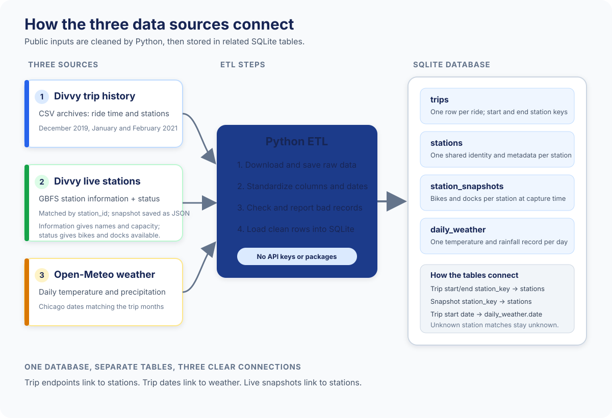

# Chicago Divvy Bike-Share Pipeline

## What this project does

This project combines Chicago Divvy bike trips, current station information, and historical weather in a local SQLite database. It then uses SQL to answer questions about trip patterns and which stations may need bikes moved.

Divvy is Chicago's bike-share service. It is the source of the trip records and station feeds; it is not itself an API. The live station data comes through Divvy's public GBFS JSON feeds, and the weather comes from Open-Meteo. These public sources require **no API keys**. The pipeline does need internet access when it downloads data.

## Architecture

The Python ETL reads and checks each source, then loads it into related SQLite tables.



The connections are:

- The two GBFS feeds are matched by `station_id` before loading.
- A trip's start and end `station_key` values link it to `stations`.
- A trip's calendar start date links it to `daily_weather.date`.
- Each `station_snapshots` row links to `stations` by `station_key`.

Each table keeps its own level of detail: one trip per row, one weather record per day, and one station-status record per station per snapshot. This avoids mixing unrelated records into one large table.

## Data used

- **Trips:** December 2019, January 2021, and February 2021. The December 2019 file is a quarterly archive, so the pipeline filters it to December trips.
- **Live stations:** GBFS station information and station status. The raw JSON responses and capture time are saved in `snapshots/`. The snapshot used for the written findings was captured on **November 16, 2026 at 14:23:22 +05:30**.
- **Weather:** Open-Meteo daily mean temperature and precipitation for Chicago (latitude 41.88, longitude -87.63) for the same 90 calendar days.

The public repository includes the code, written analysis, and a raw GBFS snapshot. It does not include the Divvy trip archives, the local trip database, or row-level quality extracts. Divvy's [data license agreement](https://divvybikes.com/data-license-agreement) restricts distributing trip records as a stand-alone dataset. Running the ETL downloads the trip archives and builds the database on your computer.

## Run the project

You need Python 3.11 or newer and internet access. No extra Python packages or API keys are needed.

Open PowerShell or the VS Code terminal in this project folder and run:

```powershell
python etl.py
```

The script downloads any missing trip or weather files, captures a fresh live station snapshot, validates and loads the data, and writes `divvy.db`. If Python is not on your PATH, run the script using the full path to your Python executable.

To see trip counts by month:

```powershell
python -c "import sqlite3; c=sqlite3.connect('divvy.db'); print(c.execute('SELECT source_month, COUNT(*) FROM trips GROUP BY source_month ORDER BY source_month').fetchall())"
```

To explore the database visually, open `divvy.db` in DB Browser for SQLite, choose **Execute SQL**, then run the statements in `queries.sql` one at a time.

The trip load is idempotent: rerunning the ETL does not add the same trip twice. Live station snapshots are append-only, so a new run can produce different station-stress and crew-ranking results.

## How the data is organized

The database uses a relational design:

- `trips`: one row per accepted ride, with start and end station keys.
- `stations`: station identity and metadata.
- `station_aliases`: source-specific station IDs mapped to a station key.
- `daily_weather`: one row per date.
- `station_snapshots`: one row per station for each capture time.
- `rejected_records`: trip rows that failed validation, with the reason.

The table definitions, primary keys, foreign keys, uniqueness rules, and indexes are in `schema.sql`. A trip's start date joins it to `daily_weather`; known station keys connect trips and snapshots to `stations`.

## How the ETL handles real source differences

The 2019 trip archive and 2021 files use different column names. The ETL recognizes equivalent names, converts the records into one trip shape, standardizes rider types, and calculates duration from the timestamps. It reads CSV rows as a stream rather than loading the complete archive into memory.

Station IDs are not assumed to mean the same thing across different sources or years. If a station name is present, the pipeline matches its normalized exact name. If only a source ID is available, it keeps a source-specific station identity. If neither name nor ID is available, it leaves that endpoint unmatched rather than guessing.

Invalid trips and live-feed conflicts are reported in `logs/quality_report.csv` and `logs/feed_quality_report.csv`. Original live JSON is preserved in `snapshots/`.

## Results at a glance

The selected periods contain **301,304 accepted trips**. In the analysis:

- Casual riders have a higher same-station trip share than members in all three periods.
- About **4.08%** of trips with classifiable station endpoints return to the same station; that is **3.82% of all accepted trips**.
- Rainy days average about **30.9% fewer trips** than dry days in this sample.
- A rule-based ranking combines current station occupancy with historical trip direction to suggest five stations for rebalancing.

These are findings for the selected data, not proof that weather or a historical trip pattern caused a live station's current status. See `analysis.md` for the calculations, evidence, and limitations.

## Data checks and challenges

The selected files contained trips longer than 24 hours, zero or negative durations, missing station names or IDs, and seven live status rows with more bikes available than the station's listed capacity. The ETL reports invalid trip rows, preserves the raw live feed, and excludes contradictory status rows from the crew ranking.

During development, I caught and fixed a legacy-file detection issue by checking the normalized column name. I also added checks for live bike counts that exceed station capacity.

## Tools and next steps

Codex helped draft parts of the ETL, schema, SQL, and analysis. The issues caught during development are described above.

For a production system, I would add run-level history and alerts, batch database writes, and use a reviewed station crosswalk that can reconcile renamed stations. PostgreSQL or a managed warehouse would be appropriate if many users or services needed concurrent access; SQLite fits this local assignment.


